

  

<h1 align="center">HRM Platform</h1>

  A multi-company HR web app: departments and shifts, daily attendance with late detection and breaks, and leave requests with approvals. A Next.js front end on a versioned NestJS REST API, with company isolation and role checks enforced on the server.

  
  
  
  
  
  

  <a href="https://hrm.everbuild.cloud"><b>Live demo</b></a> ·
  <a href="https://hrm.everbuild.cloud/docs"><b>API docs</b></a> ·
  <a href="https://portfolio.everbuild.cloud"><b>Portfolio</b></a> ·
  <a href="https://linkedin.com/in/dafallah-ibrahim"><b>LinkedIn</b></a>

> This is a showcase repository. The source code is private (team project in a private GitHub organisation). It documents what the product does, how it's built and my role. Happy to walk through the code in an interview.

## Try the demo

Open [hrm.everbuild.cloud](https://hrm.everbuild.cloud). The sign-in page lists two shared demo accounts with a one-click **Use** button each:

| Account | Email | What you can do |
| --- | --- | --- |
| Demo admin | `demo.admin@example.com` | Manage the demo company: employees, departments, shifts, leave types and balances, approvals, team attendance |
| Demo employee | `demo.employee@example.com` | Check in and out, take breaks, request leave, see your own history and balances |

The passwords are printed on the sign-in page. Everything in the demo company is sample data with made-up names, and other visitors use the same accounts, so you may see their changes. The demo admin is an ordinary company admin: the API keeps it inside the demo company.

## Screenshots

All screenshots are real captures of the live demo, signed in with the demo accounts above.

  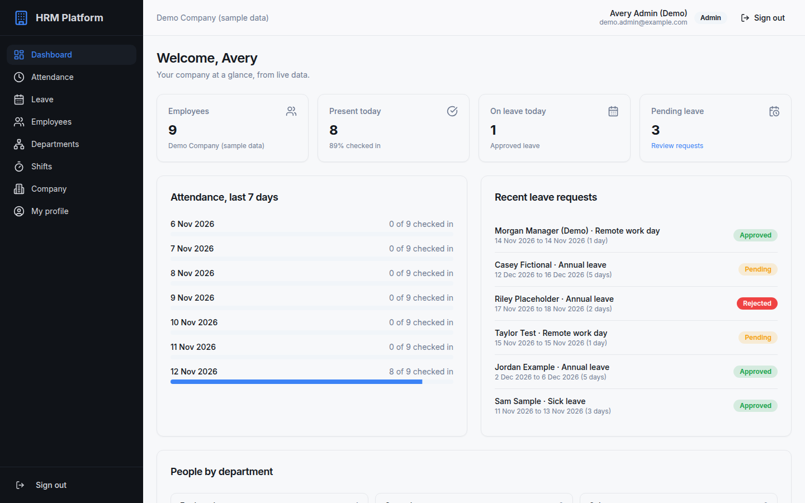

  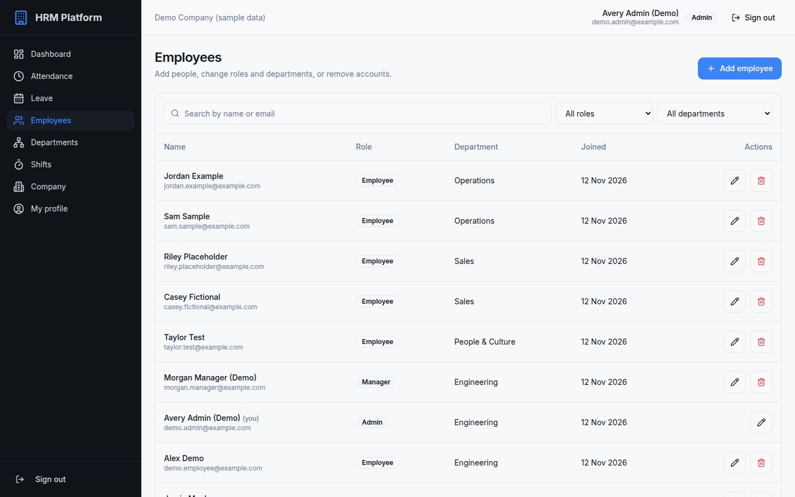
  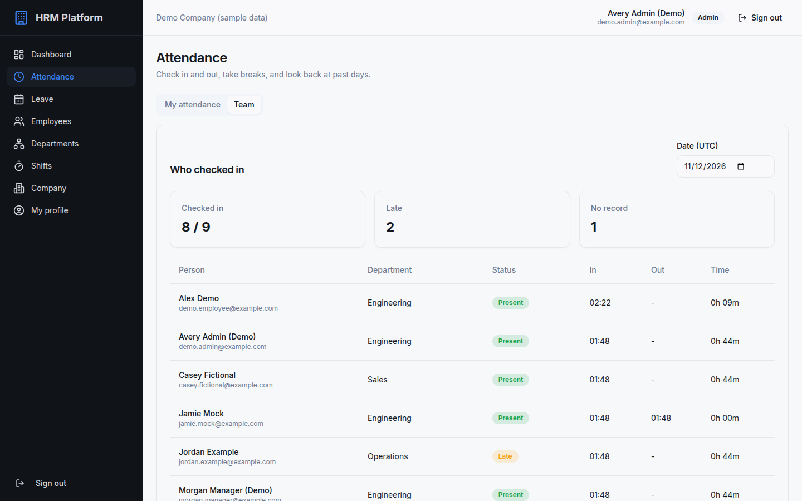

  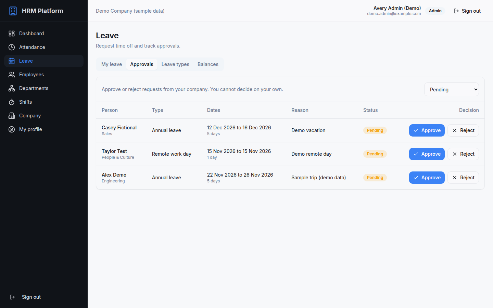
  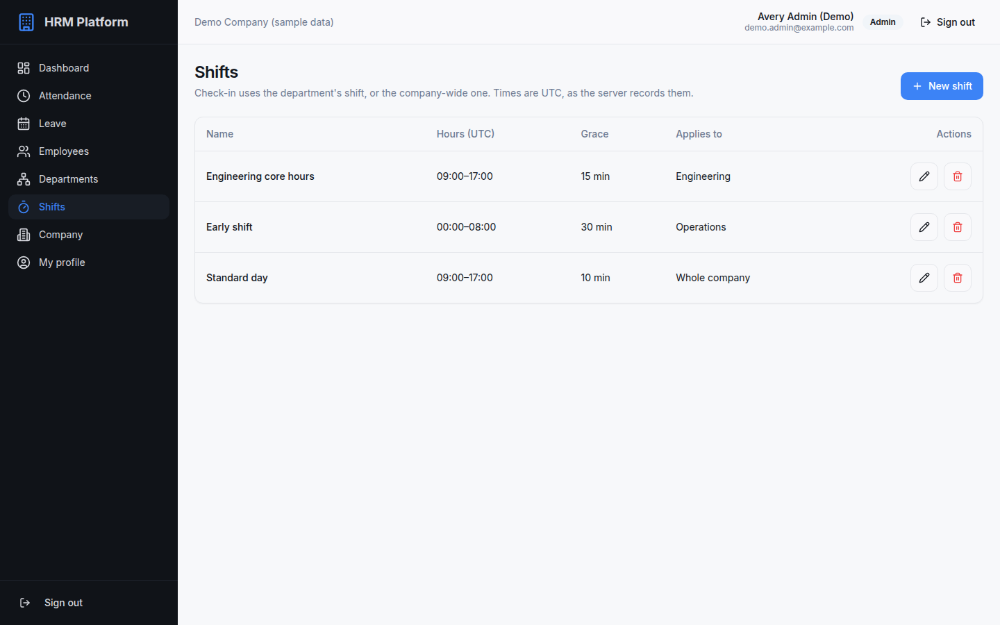

  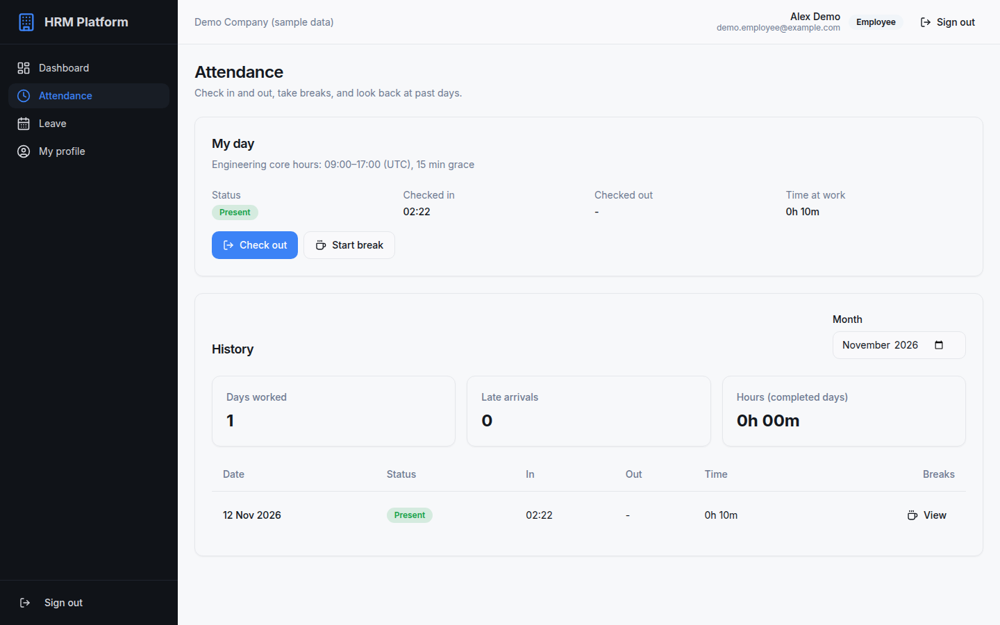
  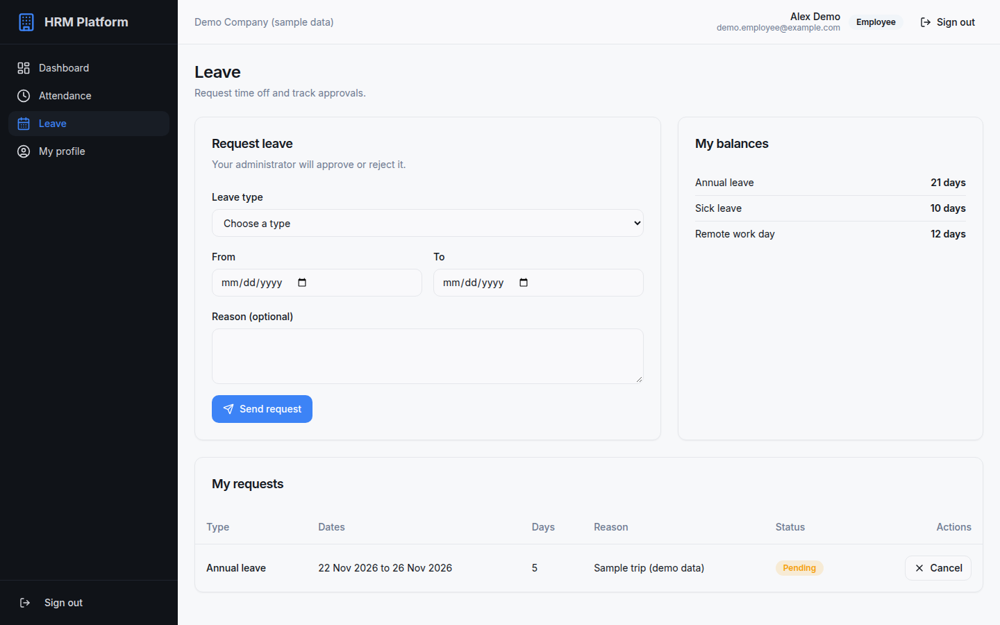

  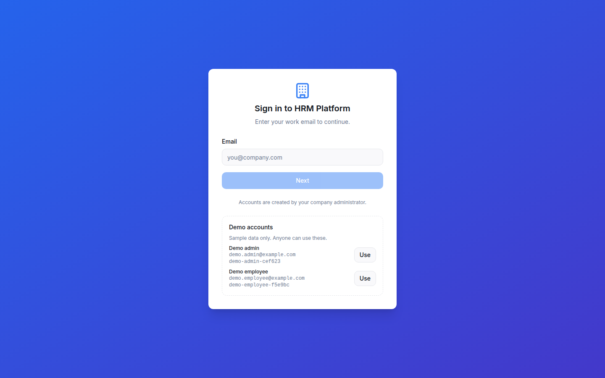

**On a phone**

  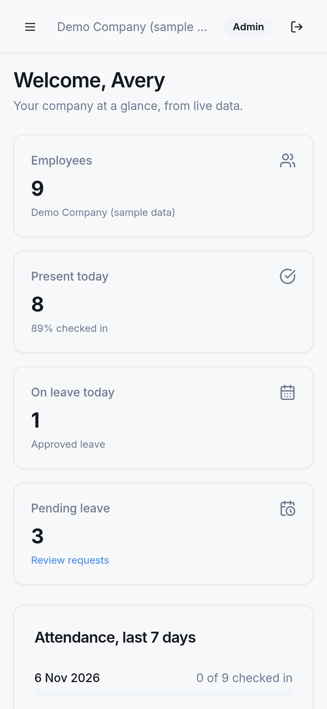
  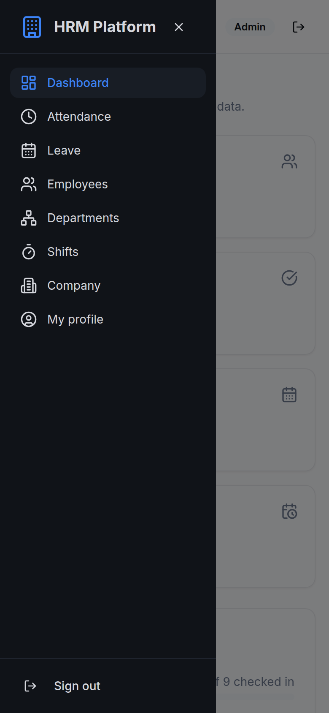
  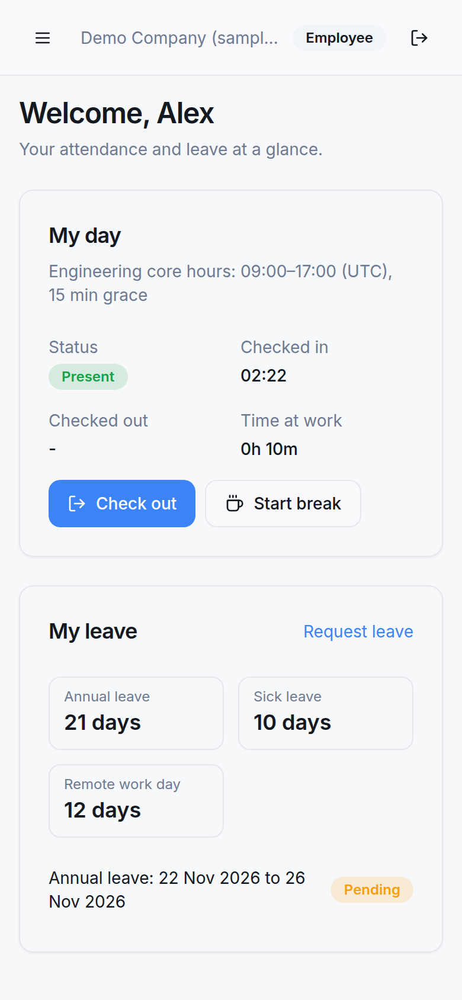
  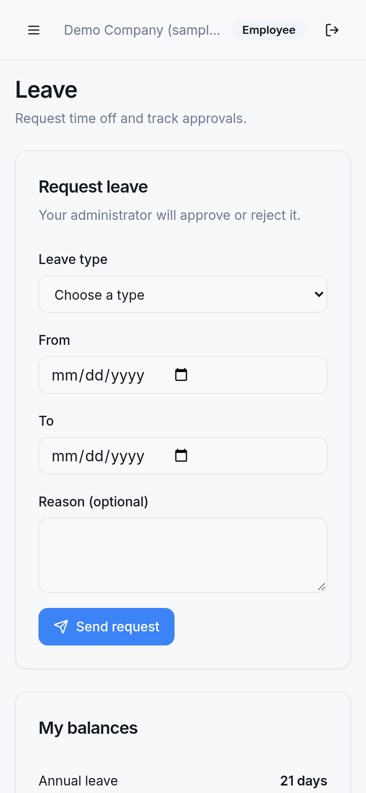

## Features

What each role gets. The API enforces every rule; the UI only hides what a role cannot use.

| Area | Employee | Manager | Admin | Super admin |
| --- | --- | --- | --- | --- |
| Two-step sign-in (email, then password), sign-out with server-side token revocation | yes | yes | yes | yes |
| Dashboard | own day and leave | + company stats | + company stats | + platform totals |
| Attendance: check in and out, breaks, monthly history | yes | yes | yes | yes |
| Attendance: team view by date | | read | read | any company |
| Leave: balances, request, cancel a pending request | yes | yes | yes | yes |
| Leave: company requests | | read | approve or reject | all companies |
| Leave types and balances | | | manage | manage |
| Employees: list, search, filter | | read | add, edit, change role or department, reset password, remove | all companies |
| Departments, shifts | | | manage | manage |
| Company | | | rename own | create, rename, delete any |
| My profile: name, password | yes | yes | yes | yes |

**Attendance rules (server side)**
- One attendance record per user per day. Check-in, check-out and breaks always act on the signed-in user.
- Status is decided at check-in: `PRESENT`, or `LATE` once the shift's grace period has passed. The shift comes from the user's department, falling back to the company-wide shift.
- One open break at a time, no break before check-in or after check-out.
- Live status (hours so far, today's shift), paginated history with a date range, daily summary for a month and weekly summary for a year, plus department and company views for a date.

**Leave**
- Leave types per company with a default number of days, and one balance per user and leave type.
- Requests always start `PENDING`. A request that overlaps one of the user's pending requests is refused. An admin of the same company approves or rejects it, never their own.

**Organisation and identity**
- Companies, departments and shifts. Shifts have UTC start and end times and a grace period, and apply to one department or the whole company.
- Four roles: `employee`, `manager`, `admin`, `super_admin`. Admins create accounts for their own company; public sign-up is off.
- bcrypt-hashed passwords and JWT access tokens. A 401 (expired, revoked, account removed) sends the browser back to the sign-in page.

## Security hardening

In November 2026, before putting the app in front of the public, I audited the API's authorization. Most routes only checked that the caller had a valid token: there were no role, ownership or company checks behind them. The fix went in as one reviewed pull request, and the live demo runs on it.

- **One access policy.** Every service asks a single policy module whether the caller may act on a given user, department, shift, leave record or company. Controllers pass in the caller from the token instead of trusting ids in the request body.
- **Company isolation.** Admins and managers only see and change their own company. Cross-company references (for example a leave type from another company) are rejected, and only a super admin works across companies.
- **Role hierarchy.** Admins manage employees and managers only. Admin and super admin accounts are created, promoted, reset and removed only by a super admin, users cannot change their own role, and the last super admin cannot be deleted.
- **Server-derived fields.** Identity, company, department and leave status come from the database, not the request. New leave is always pending, and attendance is always recorded for the caller.
- **Tokens.** Every request re-loads the user, so the role and company come from the database. A per-user token version revokes old tokens on logout or password change, and deleted accounts get 401. The signing algorithm is pinned, and the app refuses to start without a configured secret.
- **First-run setup.** The first super admin can only be created once, with a one-time token held on the server. Onboarding a company is super admin only.
- **Sign-in.** Rate limits per client IP and per account, the same error for an unknown email and a wrong password, and an email check that only answers whether the account exists.
- **Transport.** CORS allowlist, Helmet headers, TLS at nginx. On the public demo, nginx also refuses requests that would rename, re-password or delete the shared demo accounts.

**How it was proved.** 22 unit suites and 3 end-to-end suites (78 tests) run against a real MySQL in CI, and the deploy job needs them to pass. One e2e suite builds two companies through the public API and checks that each kind of cross-role and cross-company request is refused while normal flows still work. Weakening the company check makes 30 of those tests fail. After deploying, I re-ran the checks against production through both public host names, and walked the UI as each demo role with a tampered browser session: the server refused everything outside the demo company.

## Architecture

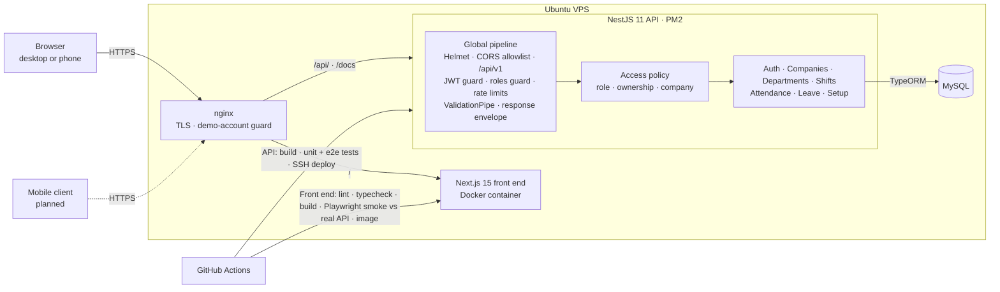

- **Same origin.** The browser loads the Next.js app and calls the API on the same host under `/api/v1`, so there is no cross-site cookie or CORS setup for the real client. Sign-in happens in the browser, so rate limits apply per visitor.
- **Data on the client.** React Query owns server state: each screen is a set of queries and mutations over one Axios client that adds the bearer token and unwraps the API's `{ status, message, code, data }` envelope. A 401 clears the session.
- **Secure by default.** The JWT guard is global, so a route is protected unless it is explicitly public. Every response, success or error, has the same envelope.

### Data model

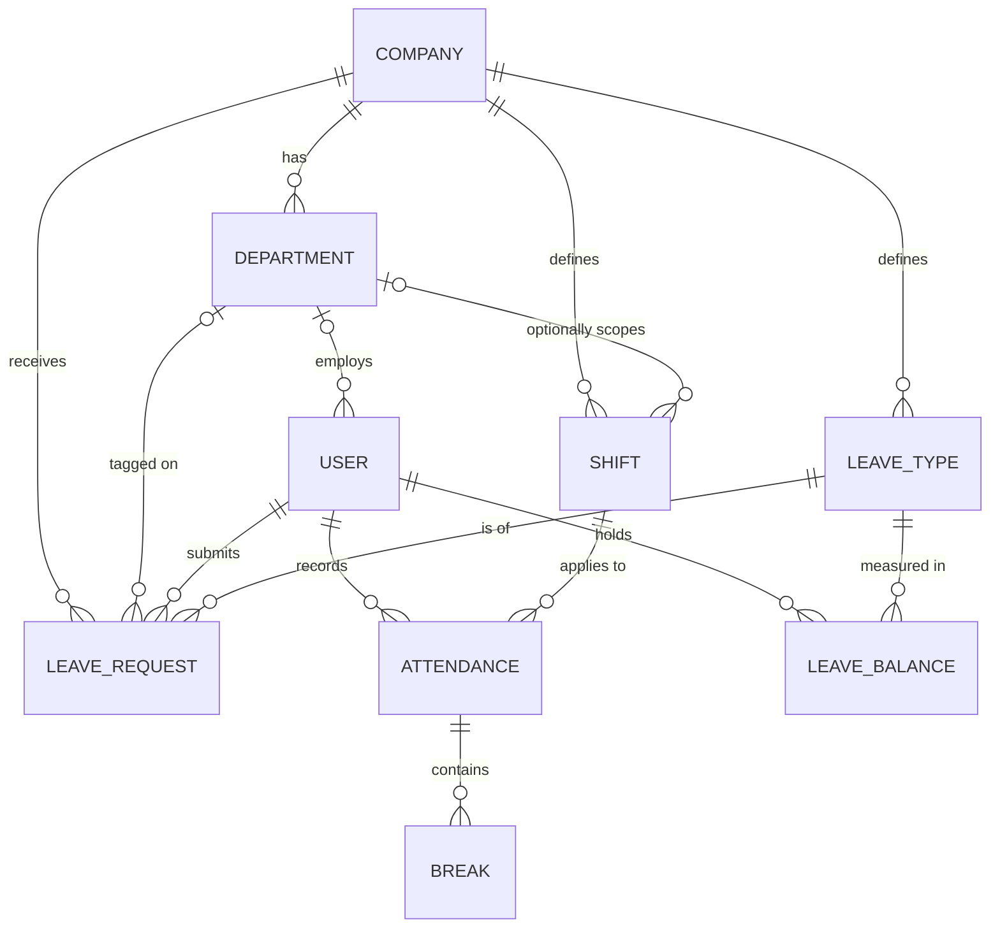

A user belongs to a company through their department. All primary keys are UUIDs. [docs/architecture.md](docs/architecture.md) covers the modules, the request pipeline, the check-in flow and the deployment in more depth.

## API

The API is public and documented with OpenAPI 3: 61 operations in 10 groups at [hrm.everbuild.cloud/docs](https://hrm.everbuild.cloud/docs).

  
  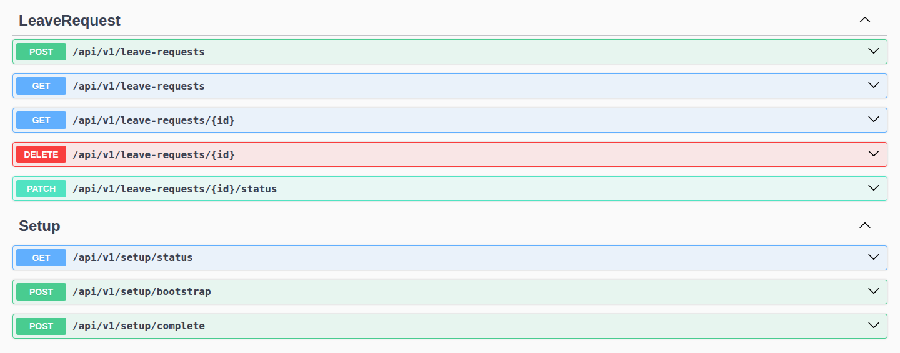

## Tech stack

| Layer | Tech |
| --- | --- |
| Front end | Next.js 15 (App Router), React 19, TypeScript (strict) |
| Front-end data and UI | TanStack React Query 5, Axios, Tailwind CSS, shadcn/ui on Radix primitives, lucide icons |
| API | Node.js 22, NestJS 11, TypeScript 5 |
| Data | MySQL via TypeORM 0.3, UUID primary keys |
| Auth and security | Passport JWT, bcrypt, central access policy, `@nestjs/throttler`, Helmet, CORS allowlist |
| Validation | class-validator, class-transformer, global `ValidationPipe` |
| API docs | `@nestjs/swagger` (OpenAPI 3.0), Swagger UI at `/docs` |
| Testing | Jest unit and e2e suites on MySQL (API), Playwright smoke tests against the real API (front end) |
| CI/CD | GitHub Actions: API build, test and SSH deploy; front-end checks, Docker image to GHCR and a release copy |
| Hosting | Ubuntu VPS, nginx reverse proxy, PM2 (API), Docker (front end) |

## My role

A team project with one other developer, in a private GitHub organisation. From the git history:

**API (Sep 2025 to Feb 2026)**
- **Foundation:** Helmet and CORS setup, URI versioning, Swagger/OpenAPI, global validation, and environment-based configuration for the database and JWT.
- **Authentication:** JWT and Passport login and registration, the Google OAuth 2.0 strategy and callback, and user deletion.
- **Access control and onboarding:** department CRUD with role-based access, and the `setup` module (company, department, shift and first user in one call).
- **Attendance for mobile:** current status, today's record, paginated history, shift info, break management and the daily and weekly summary endpoints.
- **Delivery:** the GitHub Actions pipeline that builds and deploys to the VPS, the PM2 ecosystem config and the post-deploy health check.

**Front end (Oct 2025):** converted the first prototype to Next.js and set up the API integration layer and project services.

**Hardening, integration and launch (Nov 2026, with AI-assisted tooling)**
- The authorization audit and fix described under [Security hardening](#security-hardening), with its unit and e2e suites and a CI test gate before deploy.
- Wired every screen of the front end to the real API, added role-based navigation, and added CI with a Playwright smoke test against the real API and a Docker image build.
- Deployed it: nginx split between the front end and the API, a resource-capped container, the demo company and its shared demo accounts.

The other developer scaffolded the API and its database connection, and built the company, department and user modules, the response envelope and exception filter, shifts, the first check-in and check-out flow and the leave module. On the front end they built the two-step sign-in screen and company listing.

## Status

- **Live:** the web app at [hrm.everbuild.cloud](https://hrm.everbuild.cloud) and the API docs at [hrm.everbuild.cloud/docs](https://hrm.everbuild.cloud/docs).
- **Development:** September 2025 to February 2026, then the security hardening and front-end launch in November 2026.
- **Next:** a scheduled reset for the shared demo data, database migrations instead of schema sync, and the planned mobile client for the attendance endpoints.

---

© 2026 Dafallah Ibrahim (documentation and screenshots). HRM Platform is a team project, shared with permission. Source code is private.

