

  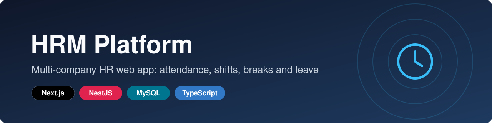

<h1 align="center">HRM Platform</h1>

  A multi-company HR backend: organisations, departments and shifts, daily attendance with late detection and breaks, and leave management, served as a versioned REST API for web and mobile clients.

  
  
  
  
  
  

  <a href="https://hrm.everbuild.cloud/docs"><b>Live API docs</b></a> ·
  <a href="https://portfolio.everbuild.cloud"><b>Portfolio</b></a> ·
  <a href="https://linkedin.com/in/dafallah-ibrahim"><b>LinkedIn</b></a>

> This is a showcase repository. The source code is private (team project in a private GitHub organisation). It documents what the product does, how it's built and my role. Happy to walk through the code in an interview.

## Screenshots

All screenshots are real captures of the live, public Swagger UI at [hrm.everbuild.cloud/docs](https://hrm.everbuild.cloud/docs). The API has no public front end, so the docs are the public face of the product. No requests were executed against it.

  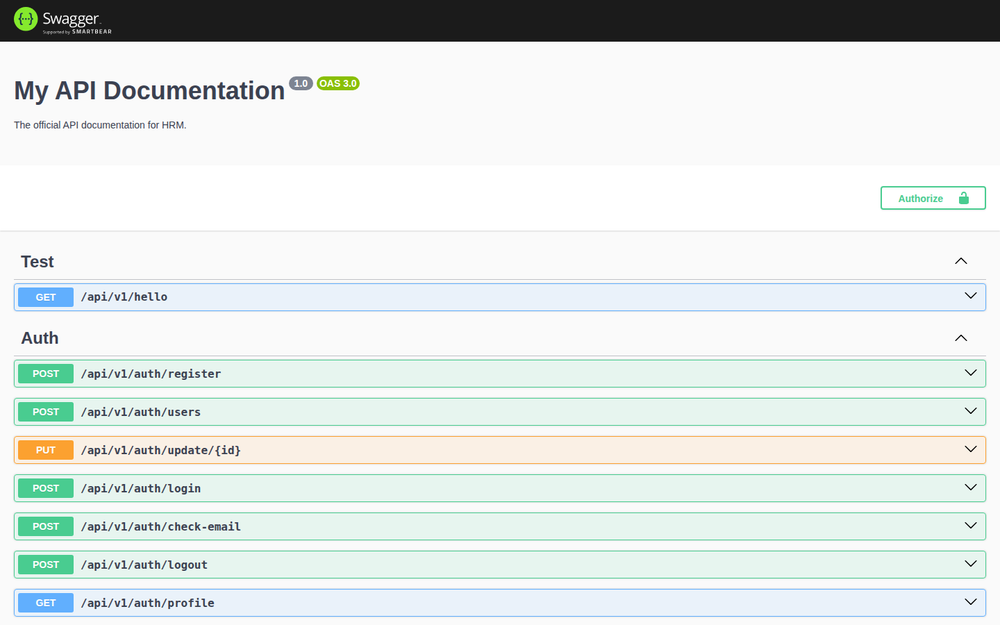

  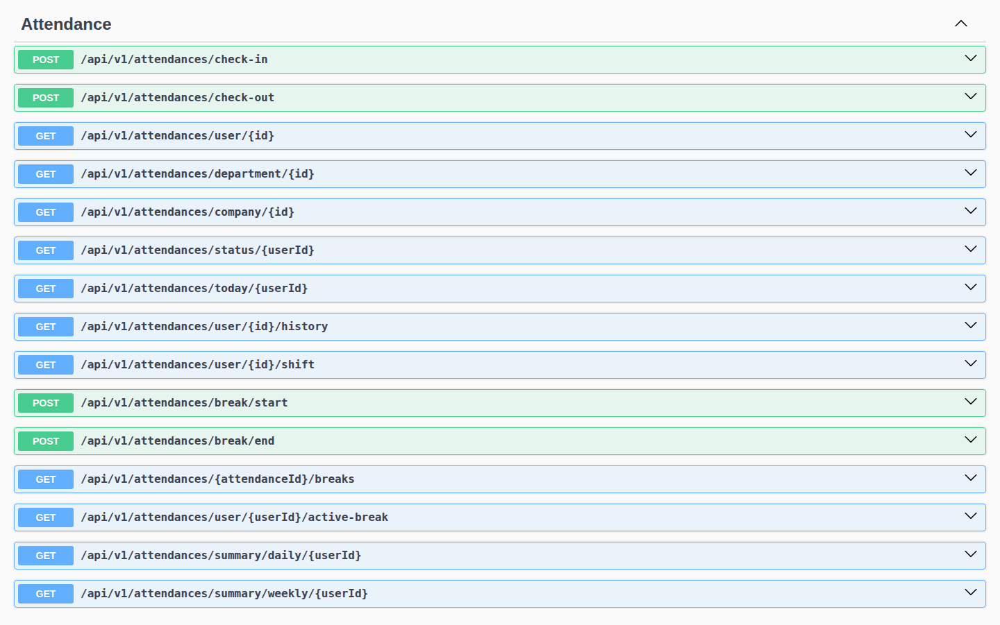
  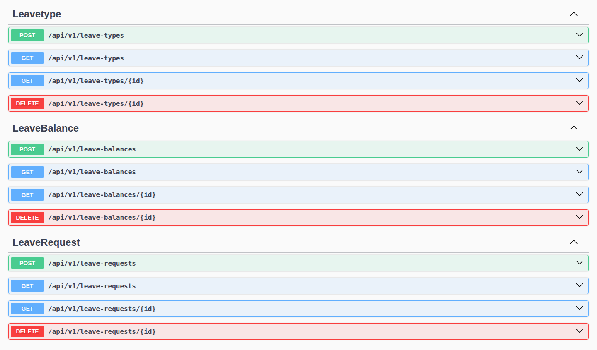

  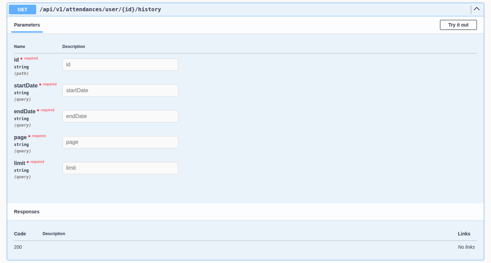
  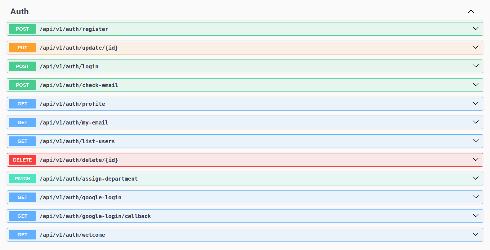

  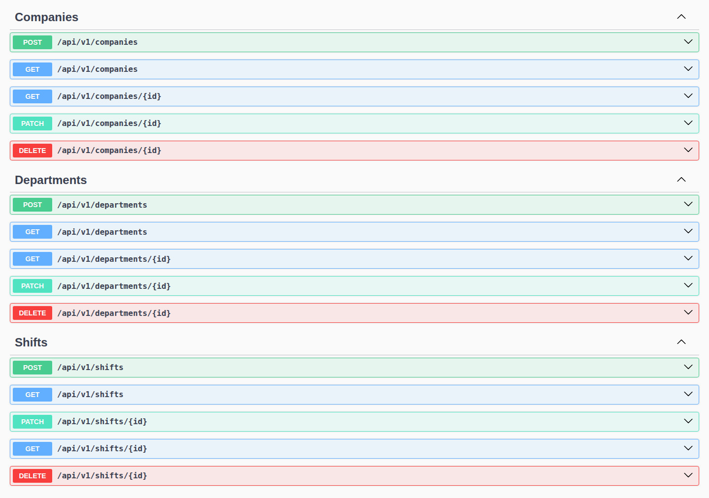

  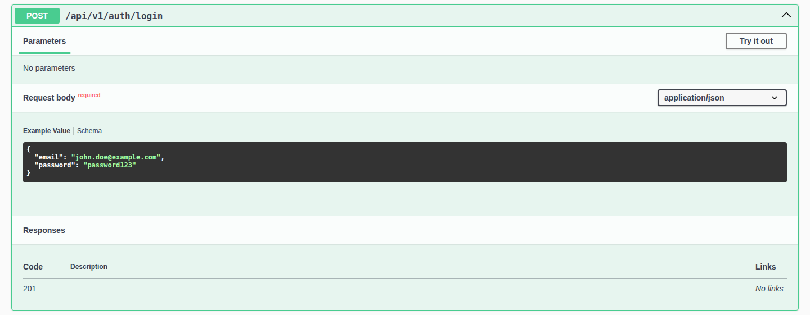

  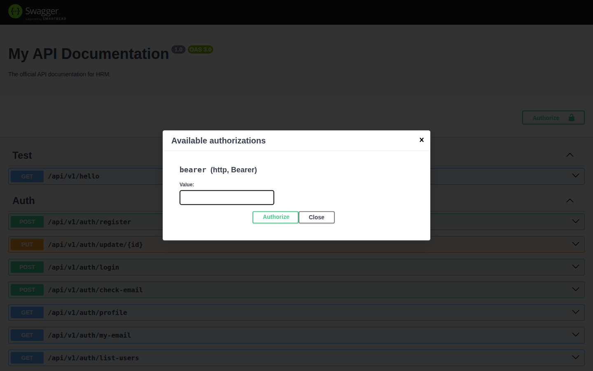

## Features

**Organisation setup**
- Companies, departments and shifts, each with create, read, update and delete endpoints.
- Orchestrated onboarding (`POST /setup/complete`, authenticated): one call creates a company, its first department, a shift and the first user, then assigns that user to the department with a role.
- Shifts belong to a company and can optionally be scoped to a department. Each has start and end times and a grace period (15 minutes by default).

**Attendance**
- Check-in and check-out, limited to one attendance record per user per day.
- Status is decided on the server at check-in: `PRESENT`, or `LATE` once the shift's grace period has passed.
- Breaks: start and end a break, list an attendance record's breaks and get the active one. Only one break can be open at a time, and no break can start after check-out.
- Endpoints for the mobile app: current status (checked in or out, hours worked so far, today's shift), today's record, and the user's shift with its late threshold.
- Paginated attendance history with an optional date range.
- Daily summary for a month (formatted check-in and check-out times and total hours) and weekly summary for a year (hours worked and missed days per week).
- Attendance views per department and per company for a given date.

**Leave management**
- Leave types per company, each with a default number of days.
- Leave balances per user and leave type, with one balance per pair.
- Leave requests per user and leave type, created as `PENDING` by default (status enum `PENDING` / `APPROVED` / `REJECTED`). A new request is rejected if it overlaps one of the user's pending requests. Approval endpoints are not part of this API yet.

**Identity and access**
- Email and password registration and login, with bcrypt-hashed passwords and JWT access tokens.
- Google OAuth 2.0 sign-in through Passport.
- Four roles: `employee`, `manager`, `admin`, `super_admin`. Company and department management and department assignment are limited to admins.

## Architecture

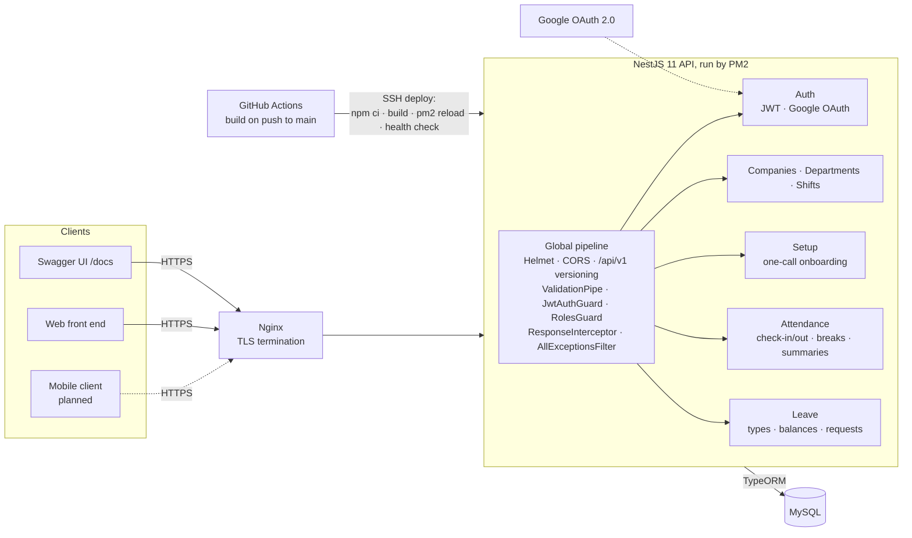

### Data model

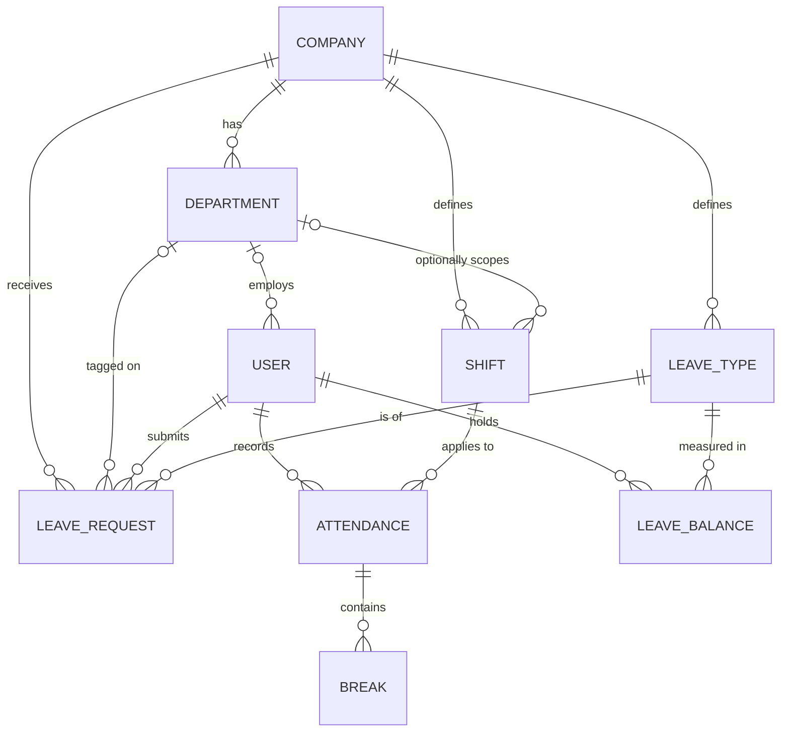

All primary keys are UUIDs. The live OpenAPI spec lists 56 operations in 10 groups. [docs/architecture.md](docs/architecture.md) covers the request pipeline, the check-in flow and the deployment in more depth.

### Key engineering decisions

- **Endpoints are protected by default.** The JWT guard is registered as a global `APP_GUARD`, so every route needs a token unless it is explicitly marked `@Public()`. Only register, login, email check, Google sign-in and a hello/test endpoint are public. Admin-only routes add a `RolesGuard` with `@Roles(...)` on top.
- **Every response has the same shape.** A global interceptor wraps successes as `{ status, message, code, data }`, and a catch-all exception filter returns errors in the same shape with `path` and `timestamp`. Mobile and web clients parse one format.
- **Attendance rules live on the server.** Check-in looks up the user's department shift and falls back to the company-wide shift (one with no department). It rejects a second check-in on the same day and works out `PRESENT` or `LATE` from the shift start and grace period. Clients never send a status.
- **Breaks are child records of attendance.** Storing them this way makes rules such as one open break at a time, no break before check-in and no break after check-out simple checks against the day's record.
- **Onboarding is one orchestrated call.** One authenticated call (`POST /setup/complete`) runs the company, department, shift and auth services in sequence to create the company, its first department, a shift and the first user, instead of duplicating that logic.
- **The API is versioned and hardened from day one.** It uses URI versioning (`/api/v1`), Helmet security headers, a whitelisting `ValidationPipe` with implicit type conversion, and `ClassSerializerInterceptor`, so password hashes (`@Exclude`) are never serialised.

## Tech stack

| Layer | Tech |
| --- | --- |
| Runtime and framework | Node.js 22, NestJS 11, TypeScript 5 |
| Data | MySQL via TypeORM 0.3 (`mysql2` driver), UUID primary keys |
| Auth | Passport JWT (`@nestjs/jwt`), Google OAuth 2.0 (`passport-google-oauth20`), bcrypt |
| Validation and serialisation | class-validator, class-transformer, global `ValidationPipe` |
| Security | Helmet (CSP, HSTS and other headers), CORS, role guard, TLS at the Nginx proxy |
| API docs | `@nestjs/swagger` (OpenAPI 3.0), Swagger UI at `/docs` |
| CI/CD | GitHub Actions: build on push to `main`, then SSH deploy |
| Hosting | Ubuntu VPS, Nginx reverse proxy, PM2 (auto-restart, memory cap) |

## My role

I co-developed the backend with one other developer, in a private GitHub organisation repository. From the git history:

- **API foundation:** Helmet and CORS setup, URI versioning, Swagger/OpenAPI setup, global validation, and environment-based configuration for the database and JWT.
- **Authentication:** JWT and Passport login and registration, the Google OAuth 2.0 strategy and callback, and user deletion.
- **Access control:** department CRUD with role-based access, linked to companies.
- **Onboarding:** the `setup` module (company, department, shift and first user in one call).
- **Attendance for mobile:** current status, today's record, paginated history, shift info, break management (start, end, list, active break) and the daily and weekly summary endpoints.
- **Delivery:** the GitHub Actions pipeline that builds and deploys to the VPS, plus (with my own automation tooling) the PM2 ecosystem config and the post-deploy health check.

The other developer scaffolded the project and the database connection. They built the company, department and user modules, the response interceptor and exception filter, shifts, the first check-in and check-out flow, and the leave module (types, balances, requests).

## Status

- **Live:** the API and its documentation are at [hrm.everbuild.cloud/docs](https://hrm.everbuild.cloud/docs).
- **Development:** September 2025 to February 2026 (first commit 16 Sep 2025, latest 4 Feb 2026).
- **Clients:** the attendance endpoints were designed for a mobile client (planned; the diagram shows it dashed), and a web front end lives in a separate private repository.

---

© 2026 Dafallah Ibrahim (documentation and screenshots). HRM Platform is a team project, shared with permission. Source code is private.

