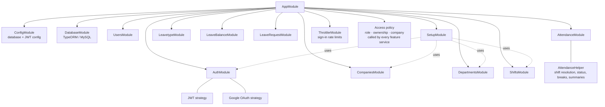
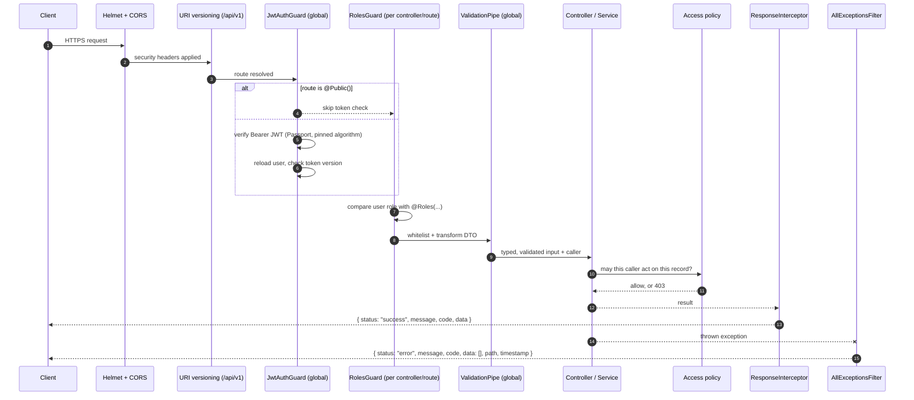
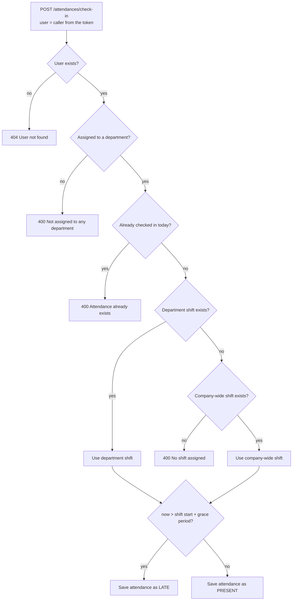
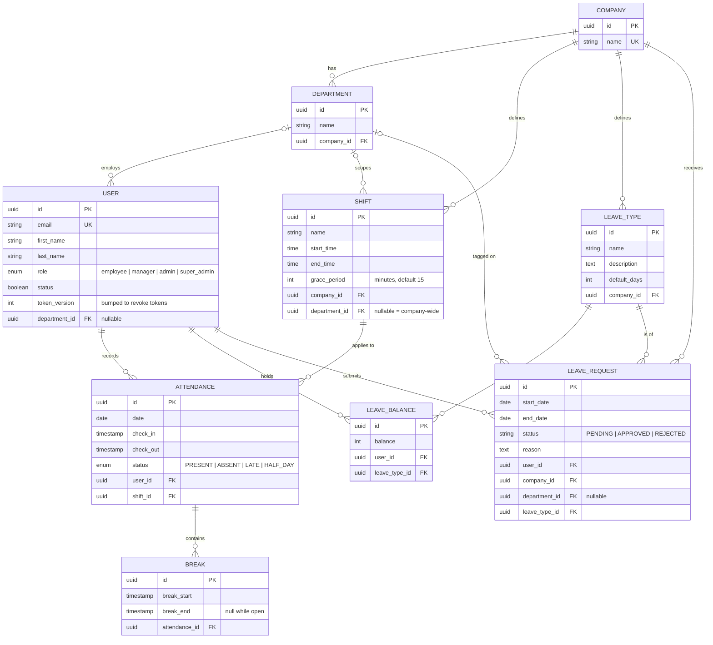
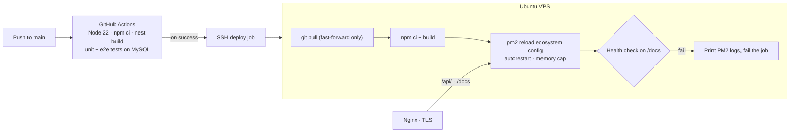
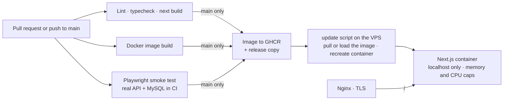

# HRM Platform architecture

This page expands on the [README](../README.md). Everything here comes from the private source code, its configuration and the live OpenAPI spec. No code is reproduced.

## Module map

The application is one NestJS process made of feature modules. Each module owns its TypeORM entities, so module boundaries match the data model.

| Module | Responsibility | Base route |
| --- | --- | --- |
| Auth | Login, logout (token revocation), email check, profile, admin-created users, user update and removal, user listing, department assignment; registration and Google sign-in are off unless configured | `/api/v1/auth` |
| Companies | A super admin manages every company; an admin reads and renames their own | `/api/v1/companies` |
| Departments | Department CRUD within the admin's company; names unique per company; a department with people in it cannot be deleted | `/api/v1/departments` |
| Shifts | Shift CRUD within the admin's company: company-wide or department-scoped, start and end time, grace period | `/api/v1/shifts` |
| Attendance | Check-in and check-out and breaks for the signed-in user; live status, history, daily and weekly summaries, department and company views for permitted readers | `/api/v1/attendances` |
| Leave types / balances / requests | Leave catalogue per company, balances per user and type, and requests (always created `PENDING`, overlap check, approved or rejected by an admin of the same company) | `/api/v1/leave-types`, `/leave-balances`, `/leave-requests` |
| Setup | Initialisation status, one-time bootstrap of the first super admin (needs a token held on the server), and super-admin-only onboarding of a company with its first department, shift and user | `/api/v1/setup` |

## Request pipeline

These cross-cutting concerns are registered once, globally, rather than per controller:

- **Secure by default:** forgetting a decorator leaves a route protected rather than open.
- **Identity from the database:** the JWT strategy re-loads the user on every request, so the role and company come from the database. A per-user token version revokes older tokens on logout or password change, and a deleted user's token gets 401.
- **One place for authorization:** services pass the caller to a single access policy, which checks role, ownership and company before anything is read or written. Ids in a request body never decide who the action is for.
- **Rate-limited sign-in:** login, email check, registration and bootstrap are limited per client IP and per account.
- **One envelope:** clients always read `status`, `message`, `code` and `data`, whether the call succeeded or failed. For validation errors the filter returns the first message as a single string.
- **No leaked secrets in responses:** `ClassSerializerInterceptor` respects `@Exclude()` on the user's password hash and token version.

## Check-in flow

Breaks follow the same pattern. A break is only allowed when today's attendance exists, the user has not checked out, and no other break is open. Ending a break closes the one open break.

## Reporting endpoints

- **Status:** checked in or out, hours worked so far (live until check-out) and today's shift.
- **History:** a query-builder query with an optional `startDate`/`endDate` range and `page`/`limit` pagination, returning total pages.
- **Daily summary:** every record in a month, with display-ready date and time strings and total hours.
- **Weekly summary:** records grouped by week number for a year, adding up hours worked and counting `ABSENT` days.
- **Department / company views:** every attendance record for a date, filtered through the user → department → company relations.

## Data model

Referential behaviour is set on the relations. Deleting a company cascades to its departments, leave types and leave requests. Deleting a department that still has people in it is refused (409), so nobody loses their company; otherwise the department is set to null on its shifts and leave requests. Deleting a user cascades to their leave balances and requests.

## Front end

The web client is a Next.js 15 App Router app (React 19, strict TypeScript) with one route per area: dashboard, attendance, leave, employees, departments, shifts, company and profile.

- **Server state** lives in TanStack React Query. Each screen is a set of queries and mutations over one Axios client that adds the bearer token, unwraps the API's response envelope and turns a 401 into "session ended": clear the session, go to `/login`.
- **UI** is Tailwind CSS with shadcn/ui components on Radix primitives. Navigation and actions are filtered by role, but only as a convenience: the API makes every decision.
- **Sign-in** is two steps (does the email exist, then the password) and runs in the browser, so the API's rate limits apply per visitor. Sign-out calls the API's logout to revoke the token.
- **Demo accounts** are read from the container's environment at request time, never baked into the image. Their sessions are treated as shared, so the profile page does not offer a name or password change for them.

## Deployment

The front end has its own pipeline:

Nothing is built on the server: the VPS only pulls or loads a finished image.

- **Zero-touch deploys:** a push to `main` builds and tests in CI first, and the deploy job only runs after both pass.
- **Process supervision:** PM2 runs the compiled app with auto-restart and a memory ceiling, and `pm2 save` persists the process list.
- **Fail loudly:** a failed health check after reload fails the pipeline and prints recent logs.
