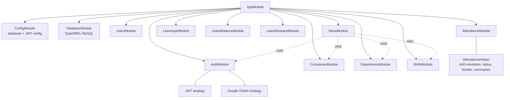
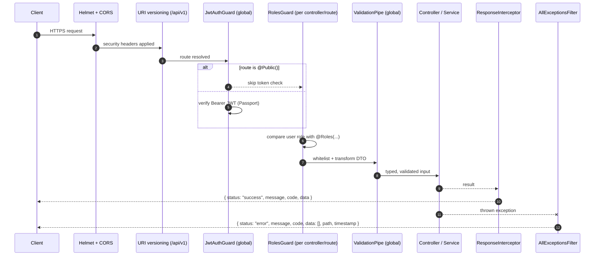
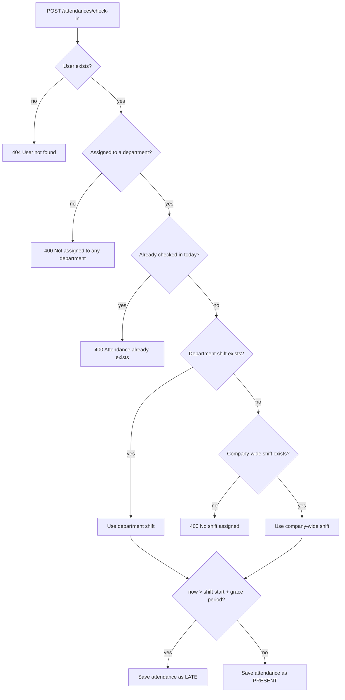
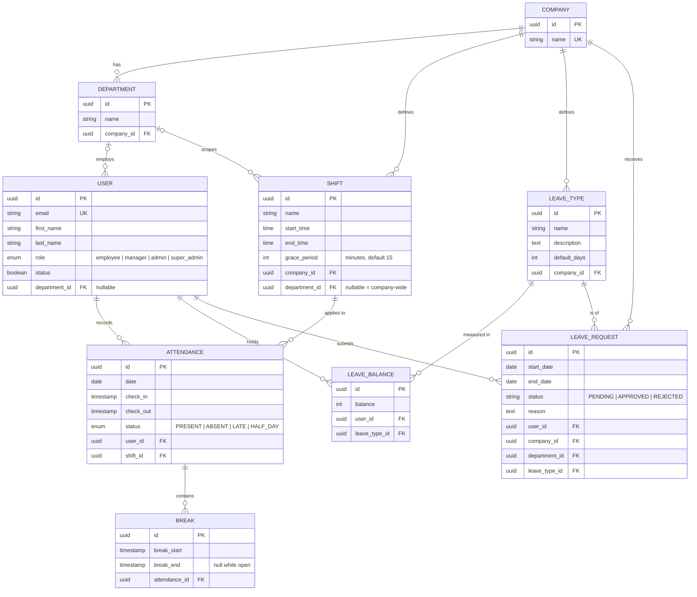
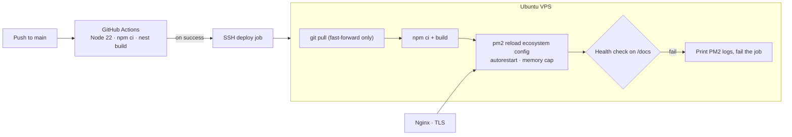

# HRM Platform architecture

This page expands on the [README](../README.md). Everything here comes from the private source code, its configuration and the live OpenAPI spec. No code is reproduced.

## Module map

The application is one NestJS process made of feature modules. Each module owns its TypeORM entities, so module boundaries match the data model.

| Module | Responsibility | Base route |
| --- | --- | --- |
| Auth | Registration, login, email check, profile, user listing, department assignment, Google sign-in | `/api/v1/auth` |
| Companies | Company CRUD (admin roles) | `/api/v1/companies` |
| Departments | Department CRUD under a company (admin roles) | `/api/v1/departments` |
| Shifts | Shift CRUD: company-wide or department-scoped, start and end time, grace period | `/api/v1/shifts` |
| Attendance | Check-in and check-out, live status, history, breaks, daily and weekly summaries, department and company views | `/api/v1/attendances` |
| Leave types / balances / requests | Leave catalogue per company, balances per user and type, and requests with an overlap check | `/api/v1/leave-types`, `/leave-balances`, `/leave-requests` |
| Setup | One-call tenant onboarding | `/api/v1/setup` |

## Request pipeline

These cross-cutting concerns are registered once, globally, rather than per controller:

- **Secure by default:** forgetting a decorator leaves a route protected rather than open.
- **One envelope:** clients always read `status`, `message`, `code` and `data`, whether the call succeeded or failed. For validation errors the filter returns the first message as a single string.
- **No leaked secrets in responses:** `ClassSerializerInterceptor` respects `@Exclude()` on the user's password hash.

## Check-in flow

Breaks follow the same pattern. A break is only allowed when today's attendance exists, the user has not checked out, and no other break is open. Ending a break closes the one open break.

## Reporting endpoints

- **Status:** checked in or out, hours worked so far (live until check-out) and today's shift.
- **History:** a query-builder query with an optional `startDate`/`endDate` range and `page`/`limit` pagination, returning total pages.
- **Daily summary:** every record in a month, with display-ready date and time strings and total hours.
- **Weekly summary:** records grouped by week number for a year, adding up hours worked and counting `ABSENT` days.
- **Department / company views:** every attendance record for a date, filtered through the user → department → company relations.

## Data model

Referential behaviour is set on the relations. Deleting a company cascades to its departments, leave types and leave requests. Deleting a department sets the department to null on users and shifts instead of deleting them. Deleting a user cascades to their leave balances and requests.

## Deployment

- **Zero-touch deploys:** a push to `main` builds in CI first, and the deploy job only runs after a successful build.
- **Process supervision:** PM2 runs the compiled app with auto-restart and a memory ceiling, and `pm2 save` persists the process list.
- **Fail loudly:** a failed health check after reload fails the pipeline and prints recent logs.
